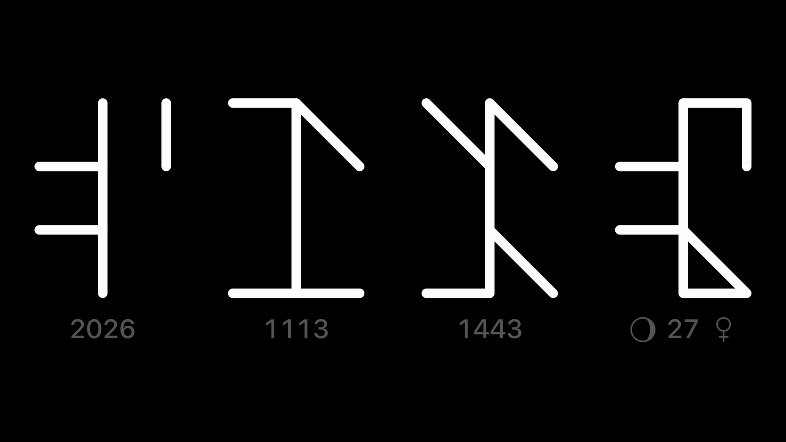
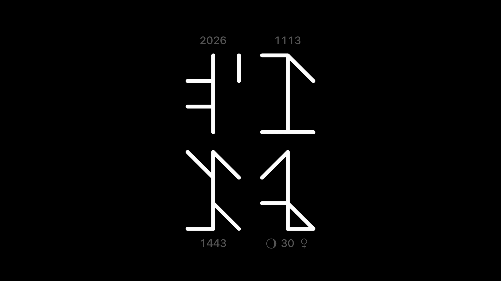
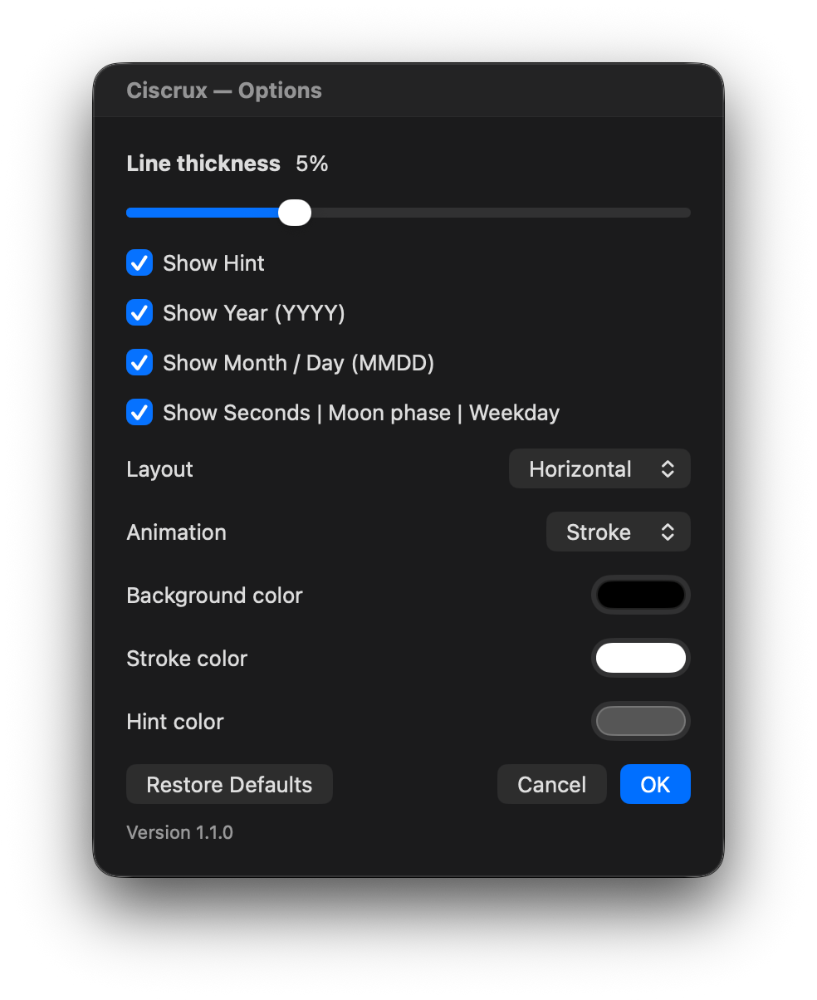

# Ciscrux

免費的 macOS 螢幕保護程式，用中世紀熙篤會（Cistercian）的數字顯示時間。

[English](README.md) | 繁體中文



## 畫面上有什麼

熙篤會數字只用一個符號，就能寫出 1 到 9999 的任何數字。Ciscrux 畫出四個這樣的符號：年、日期、時間和秒。上面截圖裡的四個符號分別是 `2026`、`1113`（11 月 13 日）、`1443`（14 點 43 分）和 `27` 秒。

- **一定看得到時間**：時和分永遠顯示；年、日期、秒可以各自關掉。
- **月相和星期**：秒的符號下半部還記著月相和星期幾。開啟 **Show Hint** 時，符號左邊會出現小月亮表示月相，右邊則是當天的行星符號。一週七天自古就各對應一顆星：星期一是月亮 ☽、星期二火星 ♂、星期三水星 ☿、星期四木星 ♃、星期五金星 ♀、星期六土星 ♄、星期日太陽 ☉。
- **一筆一筆畫出來**：數字改變時，新的符號會一筆一筆畫上去。也可以改成淡入淡出，或直接切換。
- **排成一列或兩列**：符號可以排成一列，也可以分成上下兩列。
- **照你的喜好調整**：顏色和線條粗細都能改；還在學怎麼讀的時候，可以在每個符號下方顯示一般的數字對照。
- **免費**。



## 怎麼讀熙篤會數字

每個符號是一條直線，四周最多有四個記號：右上是個位、左上是十位、右下是百位、左下是千位。四個角落都用同一組記號表示 1 到 9，只是左右或上下翻轉過來；0 就留白。

更多介紹見 [Wikipedia](https://en.wikipedia.org/wiki/Cistercian_numerals)（英文）。

## 安裝

需要 macOS 11 以上，Apple 晶片或 Intel 的 Mac 都可以。Ciscrux 已用 Developer ID 簽章，並經過 Apple 公證。

### 直接下載

1. 從[最新版本](../../releases/latest)下載 [`Ciscrux.zip`](../../releases/latest/download/Ciscrux.zip)。
2. 打開 zip，雙擊 **Ciscrux.saver**。macOS 會問是否要安裝這個螢幕保護程式，按「安裝」。
3. 打開螢幕保護程式的設定，選 **Ciscrux**。新版 macOS 在「系統設定」→「背景圖片」→「螢幕保護程式⋯」；舊版 macOS 則在「系統設定」（或「系統偏好設定」）裡找「螢幕保護程式」。再按「選項⋯」調整要顯示的內容。

要移除時，到 `~/Library/Screen Savers` 刪掉 `Ciscrux.saver`；如果當初是裝給所有使用者，則在 `/Library/Screen Savers`。在 Finder 選「前往」→「前往檔案夾⋯」，貼上路徑就能打開這個資料夾。

### Homebrew

```sh
brew install --cask vulcanshen/tap/ciscrux
```

更新用 `brew upgrade --cask ciscrux`。移除用 `brew uninstall --cask ciscrux`。

## 選項

選項視窗目前只有英文，下表照畫面上的名稱列出。



| 選項 | 作用 |
|---|---|
| **Line thickness** | 線條粗細，以符號高度的百分比計算，1–15%，預設 5%。 |
| **Show Hint** | 在每個符號下方顯示一般的數字，秒的旁邊也會出現月亮和當天的行星符號。預設關閉。 |
| **Show Year (YYYY)** | 顯示年。 |
| **Show Month / Day (MMDD)** | 顯示月和日。 |
| **Show Seconds \| Moon phase \| Weekday** | 顯示秒，連同月相和星期。 |
| **Layout** | **Horizontal** 把所有符號排成一列。**Stacked** 分成上下兩列：四個符號時排成 2×2，兩個或三個時把時間放在上面。 |
| **Animation** | **Stroke** 一筆一筆畫出新符號，**Fade** 淡入淡出，**None** 直接切換。 |
| **Background color**、**Stroke color**、**Hint color** | 背景、符號，以及符號下方數字的顏色。 |
| **Restore Defaults** | 把所有選項恢復成預設值，按 **OK** 才會套用。 |

## 為什麼叫「Ciscrux」？

`cis-` 取自 Cistercian（熙篤會），加上拉丁文的 *crux*，意思是「十字」；英文 *the crux of the matter*（問題的關鍵）用的也是這個字。Crux 同時也是南十字座的名字。

## 意見回饋

問題與建議請到 [Issues](../../issues) 回報，並附上版本號，版本號寫在選項視窗的左下角。原始碼不公開。

## 貢獻者

<a href="https://github.com/vulcanshen"></a>
<a href="https://github.com/claude"></a>

由 [Vulcan Shen](https://github.com/vulcanshen) 與 [Claude](https://github.com/claude) 使用 Claude Code 開發。

## 授權

Ciscrux 可免費下載與使用。© 2026 Vulcan Shen，保留所有權利。Ciscrux 依「現狀」提供，不附任何形式的保證。
