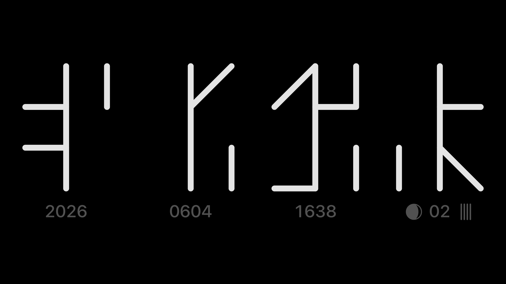
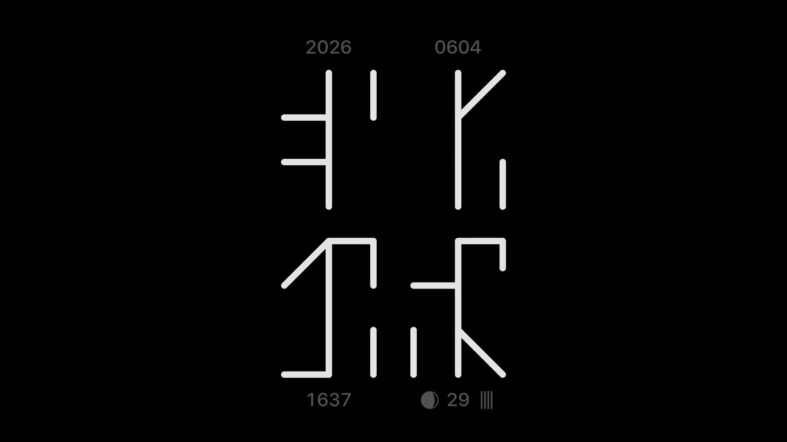

# Ciscrux

A free macOS screen saver that tells the time in medieval Cistercian numerals.

English | [繁體中文](README-zh_TW.md)



## What you'll see

Cistercian numerals write any number from 1 to 9999 as a single figure. Ciscrux uses four of them: the year, the date, the time and the seconds. In the screenshot above they read `2026`, `0604` (June 4), `1638` (16:38) and `02` seconds.

- **Always the time**: the hour and minute are always shown. The year, the date and the seconds can each be turned off.
- **Moon phase and weekday**: the seconds figure also carries the moon phase and the day of the week in its lower half. A small moon on its left and tally marks on its right show the same thing at a glance, one mark for Monday up to seven for Sunday.
- **Drawn stroke by stroke**: when a number changes, the new figure is drawn one stroke at a time. You can switch to a cross-fade or an instant change.
- **One row or two**: line the figures up in a row, or stack them in two rows.
- **Make it yours**: pick the colors and the line thickness, and show the regular digits under each figure while you learn to read them.
- **Free**.



## Reading Cistercian numerals

Each figure is a vertical line with up to four marks around it. The mark in the upper right is the ones, the upper left the tens, the lower right the hundreds and the lower left the thousands. The same nine marks stand for 1 to 9 in every corner, just mirrored; 0 is left blank.

More on [Wikipedia](https://en.wikipedia.org/wiki/Cistercian_numerals).

## Install

Requires macOS 11 or later, on Apple silicon or Intel. Ciscrux is signed with a Developer ID and notarized by Apple.

### Download

1. Download [`Ciscrux.zip`](../../releases/latest/download/Ciscrux.zip) from the [latest release](../../releases/latest).
2. Open the zip and double-click **Ciscrux.saver**. macOS asks whether to install the screen saver; click **Install**.
3. Open the screen saver settings and choose **Ciscrux**. On recent macOS they're in **System Settings → Wallpaper → Screen Saver…**; on older versions, look for **Screen Saver** in System Settings (or System Preferences). Click **Options…** to change what it shows.

To uninstall, delete `Ciscrux.saver` from `~/Library/Screen Savers` (or from `/Library/Screen Savers` if you installed it for all users). In Finder, choose **Go → Go to Folder…** and paste the folder path.

### Homebrew

```sh
brew install --cask vulcanshen/tap/ciscrux
```

Update with `brew upgrade --cask ciscrux`. Uninstall with `brew uninstall --cask ciscrux`.

## Options

| Option | What it does |
|---|---|
| **Line thickness** | Line width as a share of the figure's height, 1–15%. Default 5%. |
| **Show Hint** | Show the regular digits under each figure. Off by default. |
| **Show Year (YYYY)** | Show the year. |
| **Show Month / Day (MMDD)** | Show the date. |
| **Show Seconds \| Moon phase \| Weekday** | Show the seconds, with the moon phase and the weekday. |
| **Layout** | **Horizontal** puts every figure in one row. **Stacked** uses two rows: four figures make a 2×2 grid, and with two or three the time sits on top. |
| **Animation** | **Stroke** draws each new figure one stroke at a time, **Fade** cross-fades, **None** changes instantly. |
| **Background color**, **Stroke color**, **Hint color** | Colors of the background, the figures and the digits under them. |
| **Restore Defaults** | Puts every option back to its default. Click **OK** to apply. |

## Why "Ciscrux"?

`cis-` from Cistercian, plus *crux*, Latin for "cross" (as in *the crux of the matter*). Crux is also the constellation of the Southern Cross.

## Feedback

Report problems and ideas in [Issues](../../issues). The source code is not public.

## Contributors

<a href="https://github.com/vulcanshen"></a>
<a href="https://github.com/claude"></a>

Built by [Vulcan Shen](https://github.com/vulcanshen) and [Claude](https://github.com/claude) with Claude Code.

## License

Ciscrux is free to download and use. © 2026 Vulcan Shen. All rights reserved. Ciscrux is provided "as is", without warranty of any kind.
